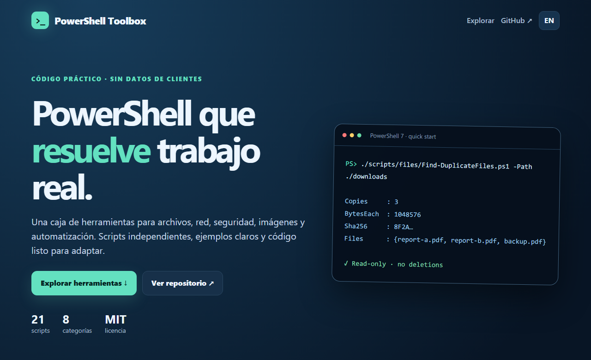

# PowerShell Toolbox

**37 scripts · 15 categorías · documentación en español e inglés**



Una colección curada de scripts PowerShell para tareas que se repiten: inspeccionar archivos, diagnosticar conexiones, revisar configuraciones y generar evidencia visual. Cada herramienta se puede ejecutar por separado; no hay instalador ni módulo obligatorio.

**[Explorar catálogo interactivo](https://peopleworks.github.io/powershell-toolbox/)** · [English documentation](README.en.md) · [Licencia MIT](LICENSE)

## Catálogo

| Tema | Herramienta | Para qué sirve |
| --- | --- | --- |
| Archivos | [Get-TextEncoding](scripts/files/Get-TextEncoding.ps1) | Identifica BOM y valida UTF-8 |
| Archivos | [Get-DirectoryInventory](scripts/files/Get-DirectoryInventory.ps1) | Lista archivos, tamaños y hashes opcionales |
| Archivos | [Find-DuplicateFiles](scripts/files/Find-DuplicateFiles.ps1) | Encuentra copias idénticas sin borrarlas |
| Archivos | [New-ArchiveFromDirectory](scripts/files/New-ArchiveFromDirectory.ps1) | Crea ZIP incluidos archivos ocultos |
| Red | [Get-TcpConnections](scripts/network/Get-TcpConnections.ps1) | Lista conexiones TCP como objetos |
| Red | [Test-Endpoint](scripts/network/Test-Endpoint.ps1) | Comprueba DNS, TCP y HTTP |
| Imágenes | [Convert-HtmlToPng](scripts/web/Convert-HtmlToPng.ps1) | Captura HTML local con Edge o Chrome |
| Imágenes | [Compare-Png](scripts/images/Compare-Png.ps1) | Cuenta cambios píxel a píxel |
| Imágenes | [Convert-DrawioToPng](scripts/images/Convert-DrawioToPng.ps1) | Exporta diagramas `.drawio` en lote |
| Seguridad | [Test-GitStagedContent](scripts/security/Test-GitStagedContent.ps1) | Revisa posibles secretos en el índice de Git |
| Seguridad | [Get-BrowserExtensions](scripts/security/Get-BrowserExtensions.ps1) | Lista extensiones de Chrome y Edge |
| Seguridad | [Get-BrowserPolicies](scripts/security/Get-BrowserPolicies.ps1) | Lee políticas de Chrome y Edge |
| Seguridad | [Get-StartupEntries](scripts/system/Get-StartupEntries.ps1) | Revisa entradas Run y tareas programadas |
| Código | [Find-DuplicateCSharpClasses](scripts/code/Find-DuplicateCSharpClasses.ps1) | Señala nombres de clases C# repetidos |
| Datos | [Test-OdbcConnection](scripts/data/Test-OdbcConnection.ps1) | Comprueba un DSN sin imprimir credenciales |
| Datos | [Get-CrystalReportInventory](scripts/reports/Get-CrystalReportInventory.ps1) | Censa metadatos de reportes `.rpt` |
| Procesos | [Wait-ProcessExit](scripts/system/Wait-ProcessExit.ps1) | Espera sin cerrar procesos |
| Procesos | [Invoke-LoggedProcess](scripts/system/Invoke-LoggedProcess.ps1) | Ejecuta con logs separados y timeout |
| Procesos | [Wait-CommandSuccess](scripts/system/Wait-CommandSuccess.ps1) | Reintenta una comprobación |
| Procesos | [Invoke-WithMutex](scripts/system/Invoke-WithMutex.ps1) | Serializa tareas entre procesos |
| Audio | [Convert-TextToSpeech](scripts/media/Convert-TextToSpeech.ps1) | Crea WAV con voz SAPI de Windows |
| Sistema | [Get-PendingReboot](scripts/system/Get-PendingReboot.ps1) | Detecta si Windows requiere reinicio |
| Sistema | [Get-ScheduledTaskSummary](scripts/system/Get-ScheduledTaskSummary.ps1) | Estado y última ejecución de tareas programadas |
| Sistema | [Get-ServiceStatus](scripts/system/Get-ServiceStatus.ps1) | Estado y modo de inicio de servicios |
| Sistema | [Get-ComputerHardware](scripts/system/Get-ComputerHardware.ps1) | Inventario de hardware (memoria, CPU, disco) |
| Seguridad | [Get-CertificateExpiry](scripts/security/Get-CertificateExpiry.ps1) | Certificados expirados o por vencer |
| Seguridad | [Get-FirewallRules](scripts/security/Get-FirewallRules.ps1) | Reglas de firewall de Windows |
| Archivos | [Clean-TempFiles](scripts/files/Clean-TempFiles.ps1) | Borra archivos temporales antiguos (con -WhatIf) |
| Red | [Get-DnsClientConfig](scripts/network/Get-DnsClientConfig.ps1) | Configuración DNS de adaptadores de red |
| Identidad | [Get-LocalUserSummary](scripts/identity/Get-LocalUserSummary.ps1) | Usuarios locales y pertenencia a grupos |
| Eventos | [Get-WindowsEventErrors](scripts/events/Get-WindowsEventErrors.ps1) | Errores del visor de eventos en un periodo |
| Actualizaciones | [Get-WindowsHotfix](scripts/updates/Get-WindowsHotfix.ps1) | Parches instalados en Windows |
| Respaldo | [Copy-BackupFiles](scripts/backup/Copy-BackupFiles.ps1) | Copia de archivos con registro de ejecución |
| Energía | [Get-PowerStatus](scripts/power/Get-PowerStatus.ps1) | Batería, plan de energía y dispositivos USB |
| Impresión | [Get-PrinterQueue](scripts/printing/Get-PrinterQueue.ps1) | Impresoras y trabajos pendientes |
| IIS | [Get-IisSiteStatus](scripts/iis/Get-IisSiteStatus.ps1) | Sitios y grupos de aplicaciones de IIS |
| Datos | [Test-SqlConnection](scripts/data/Test-SqlConnection.ps1) | Prueba de conexión ODBC a SQL Server |

## Prueba rápida

Desde la raíz del repositorio, en PowerShell 7:

```powershell
./scripts/files/Get-TextEncoding.ps1 -Path ./README.md
./scripts/files/Get-DirectoryInventory.ps1 -Path ./examples -IncludeHash
./scripts/security/Test-GitStagedContent.ps1 -Repository .
New-Item -ItemType Directory -Force ./.local | Out-Null
./scripts/web/Convert-HtmlToPng.ps1 -Html ./examples/demo.html -Output ./.local/demo.png -Width 1200 -Height 630
./scripts/images/Compare-Png.ps1 -Reference ./examples/demo.png -Current ./.local/demo.png
```

Ejemplos para entornos con datos propios:

```powershell
./scripts/data/Test-OdbcConnection.ps1 -Dsn ExampleDsn -Credential (Get-Credential)
./scripts/reports/Get-CrystalReportInventory.ps1 -Path ./reports -Output ./.local/inventory.json
```

`ExampleDsn`, `./reports` y `./.local` son valores de ejemplo. Cree la carpeta de salida antes de exportar. Los archivos de inventario pueden contener nombres de tablas, ubicaciones y prompts: guárdelos fuera del repositorio o bajo `.local/`, que Git ignora. No ponga contraseñas en scripts ni en el historial de comandos.

## Diseño

- Las herramientas de inspección devuelven objetos PowerShell para poder encadenar `Where-Object`, `Export-Csv` y `ConvertTo-Json`.
- Las herramientas que escriben imágenes requieren una ruta explícita o utilizan el nombre del HTML. Evitan sobrescribir archivos salvo con `-Force`.
- La detección de texto indica `Unknown` cuando los bytes no permiten identificar una codificación con seguridad.
- El inventario Crystal requiere su runtime; no incluye bibliotecas de terceros en este repositorio.
- La auditoría de Git es heurística: una revisión humana sigue siendo necesaria antes de publicar.

Estos scripts fueron adaptados de utilidades de trabajo y reescritos para uso general. El repositorio contiene solo código, documentación y un HTML ficticio; no contiene configuraciones, resultados ni datos de clientes.

## Comprobación y contribuciones

```powershell
./tests/Smoke.ps1
```

La prueba comprueba la sintaxis de los 21 scripts y ejecuta casos sintéticos para archivos, procesos e imágenes. Para proponer otra herramienta, vea [CONTRIBUTING.md](CONTRIBUTING.md).
